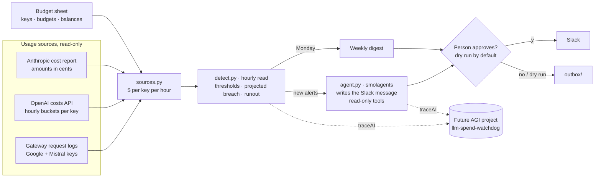

# LLM spend watchdog

Model spend is spread across providers, keys and teams. A monthly budget or a
prepaid balance can run out without anyone noticing, and the features that
use it break.

Every hour, the watchdog reads usage for each provider and key. It writes a
Slack alert when spend crosses 50%, 80% or 100% of a budget, when a budget is
on course to be passed before the month ends, or when a prepaid balance is
about to run out. Each alert lists the top 5 keys by spend. Every Monday it
also writes a weekly summary.

It only reads usage: it never tops up a balance or turns a key off, and it
never posts anything until a person approves it.

## How it works



**Detection is code, not the LLM.** `detect.py` decides what to alert on, so it
can be tested against ground truth. The agent writes the message people read:
the most urgent alert first, who owns it, the numbers behind it, the top
spenders and a next step. Its tools only read (`get_new_alerts`,
`get_top_spenders`, `get_daily_spend`). Without an LLM key, a template writes
the message instead.

**Rules**

| Alert | Fires when |
|---|---|
| Threshold | Month-to-date spend passes 50%, 80% or 100% of a key, provider or org budget. If several levels are passed between reads, one line for the highest. |
| Projected breach | Month-to-date + burn rate × hours left > budget, for 3 reads in a row. The ETA uses the last 6 hours' pace. |
| Balance runout | A prepaid balance is projected to hit zero within 72 hours, for 3 reads in a row. |
| Balance empty | A prepaid balance has hit zero. |

Each alert fires once per scope and level per month. Thresholds, the runout
window and the 3-read rule are settings in `.env`.

**Burn rate** per key is the larger of two robust rates:
- recent: the last 24 hours with the 4 most expensive hours left out, so a backfill or one big eval run doesn't raise an alarm
- weekly: the last 7 days with the top 3% of hours left out, so nightly batch jobs and weekends are counted

A balance's runout time walks forward hour by hour from the same hour last
week, scaled by how the last day compares with the same day a week earlier.
Weekdays cost more than weekends, so this is closer than a flat rate.

## Run it

Needs Python 3.10 or newer.

```bash
make demo
```

This installs everything into `.venv`, writes the synthetic month to
`data/sample/`, replays it hour by hour, then writes the weekly digest. Nothing
is posted; every message is saved under `outbox/`.

Other commands:

```bash
make check          # one hourly read, at the moment the runaway key is first flagged
make eval           # the 24-case eval suite (no keys needed)
make test           # unit tests
.venv/bin/python -m watchdog check --approve   # a live read: shows the message, posts only after you type y
```

Keys go in `.env` (copied from `.env.example` on setup):

| Variable | For |
|---|---|
| `FI_API_KEY`, `FI_SECRET_KEY` | traceAI: every hourly read and every agent step becomes a trace in the Future AGI project `llm-spend-watchdog`. Also the cloud evals. |
| `LLM_MODEL`, `ANTHROPIC_API_KEY` (or another provider's key) | The agent writes the messages. Any LiteLLM model id. |
| `SLACK_WEBHOOK_URL` | Posting, only with `--approve` and only after you type y. |
| `*_SHEET_CSV_URL` | The budget sheet's tabs, published as CSV. Empty: `data/sample/*.csv`. |

## The synthetic month

`data/generate.py` makes November 2026: 4 providers (OpenAI, Anthropic, Google,
Mistral), 12 keys, a daily pattern with quieter weekends, and noise.

- `oa-support-bot` starts a retry loop on day 18 at 14:00 (+$5.50 an hour) and passes its $380 budget on day 20.
- The Mistral prepaid balance runs out on day 25 at 15:00.
- `an-coding` has a one-off $38 spike on day 10, which shouldn't trigger a projection.

Usage is written in the shapes the watchdog reads: gateway request logs (one
JSON line per request, with fake provider secrets in the headers), OpenAI-style
hourly cost buckets, and an Anthropic-style cost report in cents. To use live
data, replace a loader in `watchdog/sources.py` with an HTTP call; the rest
doesn't change.

**On the sample month** (the bar for this agent): the runaway key is flagged
on day 18 at 22:00, 33 hours before it passes its budget. The balance is
flagged on day 22 at 20:00, 68 hours before it hits zero. There are no false
alerts.

```
2026-11-18 22:00 UTC  projected_breach  key:oa-support-bot
2026-11-18 23:00 UTC  projected_breach  provider:openai
2026-11-19 04:00 UTC  projected_breach  org:all
2026-11-22 20:00 UTC  runout            balance:mistral-prepaid
2026-11-25 16:00 UTC  balance_empty     balance:mistral-prepaid
25 alerts in 24 messages; 0 false.
```

## Evals

`make eval` runs the watchdog over 24 synthetic months (`evals/cases.py`):
runaway keys starting on different days, retry loops fixed after 2–4 hours,
one-off spikes and backfills, slow growth, balances running out on days 12,
18, 20, 25 and 29, and quiet months.

Future AGI evals, from the `ai-evaluation` SDK:

| Eval | What it checks | Score |
|---|---|---|
| `numeric_similarity` | Projected month-end spend vs actual, on days 8, 15 and 22, for keys with nothing injected | **0.971** |
| `numeric_similarity` | Hours until a budget is passed: the first projected-breach alert vs what happened | **0.806** |
| `numeric_similarity` | Hours until a balance hits zero: the first runout alert vs what happened | **0.963** |
| `contains_none` | No message contains any of the month's secrets, or anything starting `sk-` or `Bearer ` | **1.000** |

Scored against the ground truth by `watchdog/score.py`:

| Metric | Result |
|---|---|
| Alert precision (no false or duplicate alerts) | **0.995**: 2 false out of 422 |
| Events warned before they happen (budgets passed, balances at zero) | **33 of 33** |
| Numbers in messages that come from the data | **1.000** |

The 2 false alerts are in `runaway-stops-after-30h`: while the loop was
running, the openai provider and org budgets were projected to be passed;
someone stopped the loop 30 hours later and they weren't. The breach ETA is
weakest there (0.13), and for slow growth (0.69), where the pace keeps rising
after the alert. For runaways it scores 0.88–0.96.

These scores are for messages written by the template. With `LLM_MODEL` and
`FI_*` keys set, `make eval-cloud` has the agent write every message and adds
Future AGI's Turing evals `groundedness` and `is_concise` on each one. All
scores land in `evals/results.json`.

## Safety

- Read-only: the watchdog needs usage-read credentials only. It never tops up, rate-limits or revokes a key.
- Nothing is posted on its own. The default is a dry run; `--approve` shows the message and posts only after a person types y. Replays and evals never post.
- No key in any alert. Keys are referred to by alias. Loaders drop request headers, and every outgoing message goes through `redact()`, which removes anything shaped like a credential. `contains_none` checks this on every message.
- All data in this repo is made up.

## Demo (3 minutes)

1. **Trigger** (0:00–0:45). `make check`: the hourly read at day 18, 22:00. The message leads with `oa-support-bot`: on course to pass its $380 budget in 32 hours (it really does, in 33), spending $145 a day over the last 6 hours against a 7-day average of $14.
2. **Output** (0:45–1:30). `make replay`: the whole month. Show the 5 projected alerts, then `outbox/replay/` and the weekly digest.
3. **Trace** (1:30–2:15). In Future AGI, project `llm-spend-watchdog`: an hourly-read span with the agent's steps, tool calls and LLM call under it.
4. **Eval scores** (2:15–3:00). `make eval`: 24 months, 33 of 33 events caught ahead of time, 2 false alerts out of 422, and the Future AGI scores above.

## Layout

```
watchdog/
  sources.py   loaders: gateway logs, OpenAI costs, Anthropic cost report, budget sheet
  detect.py    the hourly read: rules, burn rate, projections
  agent.py     smolagents agent that writes the Slack message
  alerts.py    template messages, weekly digest, redaction
  slack.py     dry run, approval prompt, webhook post
  tracing.py   traceAI setup and spans
  run.py       check, replay, weekly digest
  score.py     ground-truth scoring
data/generate.py   the synthetic month
evals/             24 cases and the eval runner
tests/             unit tests
```

## Not in v1

Topping up balances, cutting keys off, and reconciling invoices.

## License

Apache 2.0. See [LICENSE](LICENSE).
